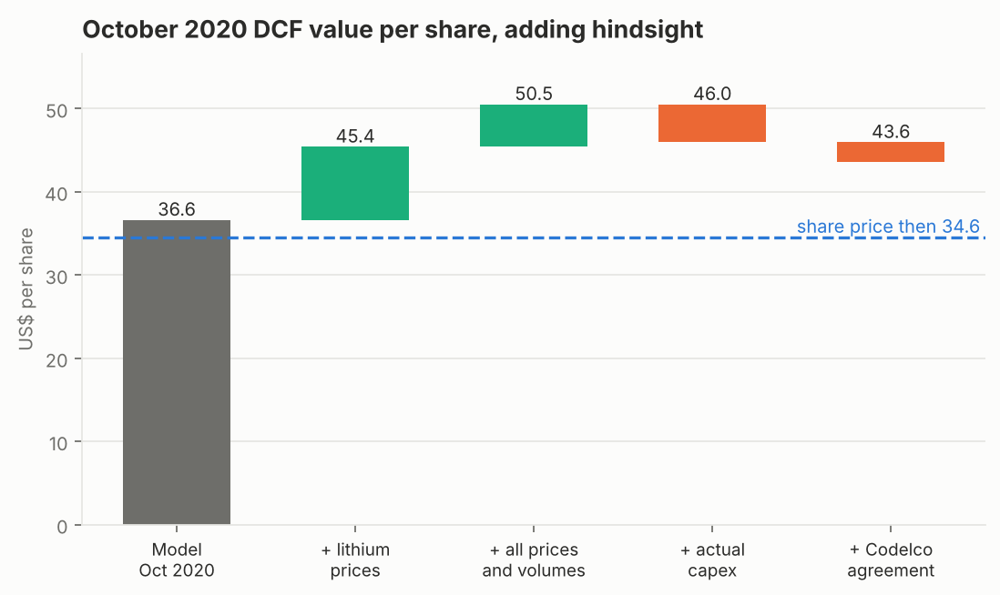

# equity-research-engine

[](https://github.com/IgnacioMendozaRojas/equity-research-engine/actions/workflows/ci.yml)

**Equity valuation and investment analysis.** A reusable valuation engine: public filings go in, a CFA-style research report comes out, with every number traceable to a source or a stated assumption.

> I won the CFA Institute Research Challenge South America regional final (2020-21) with my team, covering SQM, and evaluated investment projects on the investment committee of a Chilean clinic group (NPV, IRR, payback). This repository rebuilds that analysis as code, from public data only; the competition report and model belong to CFA Institute and are not here.

The first case is **SQM** (Sociedad Química y Minera de Chile), valued twice:

- **[October 2026: full report](companies/sqm/reports/2026-10-16.md).** **SELL**, target **US$42.2** vs US$60.2 per ADR. The share price assumes lithium at about **US$25,100/t** from 2028; our deck uses US$15,000/t.
- **[October 2020: retrospective](companies/sqm/reports/2020-10-16.md).** The same engine, restricted to what was public on 16 October 2020, gives **HOLD** at US$34.9 vs US$34.6. It is then held against what actually happened.

<picture>
  <source media="(prefers-color-scheme: dark)" srcset="companies/sqm/reports/figures/backtest-value-walk-dark.png">
  
</picture>

With perfect knowledge of 2020-2025, the 2020 value rises only from US$36.6 to US$43.6, while shareholders earned +89% including dividends. The 2022 lithium spike (US$52,000/t realised) mostly went to the Chilean state: the Corfo lease takes 40% of every dollar above US$10,000/t before income tax. The extra volume needed three to six times the capex. The Codelco agreement cuts SQM's share of the Atacama margin to about 15% from 2031. The rest of the return is the market's higher long-run lithium price.

### Monitor

Between full reports the assumptions stay fixed and the share price moves. A weekly workflow
([`monitor.yml`](.github/workflows/monitor.yml)) fetches the latest close and recomputes the upside and the long-run
lithium price the market is paying for; the result is in [`companies/sqm/latest.json`](companies/sqm/latest.json).

<!-- latest:sqm:start -->
**Monitor, 2026-10-26.** At US$56.97, SQM's share price implies lithium at about US$23,279/t in the long run; the model's deck uses US$15,000/t and gives US$42.23 per share (SELL).

| Indicator | Value | As of |
|---|---:|---|
| SQM share price | US$56.97 | 2026-10-26 |
| Long-run lithium price implied by the share price | US$23,279/t | 2026-10-26 |
| Long-run lithium price in the model's deck | US$15,000/t | 2026-10-16 |
| Model value per share (DCF + residual income) | US$42.23 | 2026-10-16 |
| Upside to model value | -25.9% | 2026-10-26 |

*Updated automatically on 2026-10-27: the share price moves, the assumptions stay those of the 2026-10-16 report until it is revised.*
<!-- latest:sqm:end -->

## What this shows

| Task in equity research or investment analysis | Where it is done here |
|---|---|
| Build a driver-based forecast | Segments as volume × price with their own costs, capex and fiscal regimes ([`model/`](src/eqr/model)) |
| Value the company two ways and reconcile them | DCF and residual income on the same projection, with a model-check table in each report ([`valuation/`](src/eqr/valuation)) |
| Say what the market is pricing in | Implied long-run lithium price, recomputed weekly from the share price ([`monitor.py`](src/eqr/valuation/monitor.py)) |
| Quantify uncertainty | 10,000 mean-reverting commodity price paths, scenarios and sensitivity tables |
| Check a past call honestly | The October 2020 valuation held against what happened, step by step ([`backtest.py`](src/eqr/valuation/backtest.py)) |
| Get the data without copying it by hand | SEC and CMF XBRL connectors, validated against each other; monthly filings workflow |

## Why it is built this way

The design fixes the errors that are easy to make in a spreadsheet valuation of a resource company:

| Choice | Why |
|---|---|
| **Segments as volume × price**, each with its own cost, capex and fiscal regime | A company whose value is moving from fertilisers to lithium cannot be forecast with one growth rate |
| **Fiscal regimes by period**: corporate tax, or a share of the margin under a state agreement | Chilean lithium is a concession with a progressive lease (to 2030) and a state partner (2031-2060). Royalties and state take decide how much of a price spike the company keeps |
| **Finite assets end; no perpetuity on a concession** | A Gordon growth model on lithium assumes the 2060 concession lasts forever |
| **Explicit horizon to 2060** | Terminal value is 5-12% of EV, not 80% |
| **Capex tied to capacity additions** | Tripling capacity with capex equal to depreciation overstates free cash flow |
| **Working capital split by driver**: receivables on revenue, inventories and payables on cost | A price spike does not mean the company stocked up at the new price |
| **Equity bridge with cash and financial assets**, terminal value discounted from year end | Leaving cash out undervalues SQM by 11-23% (see the model-check table in each report) |
| **DCF and residual income from one projection and one cost of equity** | The two methods cross-check each other instead of averaging inconsistent answers |
| **No size or "company-specific" premium in the discount rate** | Company risks belong in the cash flows and the scenarios, or they are counted twice |
| **Monte Carlo on mean-reverting lognormal prices**, volatility from realised prices | Prices stay positive and skewed; the deck is the mean, not a point forecast |
| **Backtest built in** | Any past valuation can be re-run with hindsight, one assumption at a time |

## Quick start

```bash
pip install -e ".[dev]"

eqr value companies/sqm 2026-10-16 --sims 10000
# SQM 2026-10-16: SELL  target US$42.23 (DCF 41.30, RIM 44.40)  price US$60.23  upside -29.9%  WACC 10.18%
# Monte Carlo: median 35.36, P5-P95 16.45-85.67, P(value > price) 15%

eqr report companies/sqm                 # writes companies/sqm/reports/*.md and figures
SEC_USER_AGENT="Your Name you@mail.com" eqr fetch-sec companies/sqm   # rebuild financials from SEC XBRL
eqr fetch-cmf companies/sqm --years 2018-2025   # same from the CMF's IFRS XBRL filings (Chilean issuers)
eqr reconcile companies/sqm              # CMF vs SEC, concept by concept
eqr news companies/sqm --days 30         # headlines tagged by risk category
eqr news companies/sqm --csv my_factiva_export.csv   # same, from a licensed terminal export
eqr fetch-price companies/sqm             # latest daily closes (needs ALPHAVANTAGE_API_KEY)
eqr monitor companies/sqm                 # latest.json: upside and implied lithium price at the latest close
```

## How it works

```
data/            providers             model/                 valuation/                 report/
SEC EDGAR XBRL ─┐
CMF XBRL filings┤                      calibrate: unit        wacc: CAPM + CRP, beta    markdown: CFA sections,
CMF API (FX/UF) ├─► company folder ──► economics from    ──► blended by EBITDA     ──► answer first, numbers
News (RSS/CSV) ─┘   data/*.csv         history               dcf: mid-year, bridge     filled from the model
                    assumptions/*.yaml projection: segments  rim: clean surplus        figures: light + dark
                    narrative/*.md     × regimes × years     montecarlo, scenarios,
                                       (n paths × T years)   sensitivity, backtest
```

The projection works on arrays of shape `(paths, years)`, so the base case, scenarios and 10,000 Monte Carlo paths all run through the same code. Monte Carlo is vectorised and takes under a second.

## Adding a company

```
companies/<name>/
  company.yaml               identifiers, segment names, SEC concept map, news keywords
  data/financials.csv        concept x year (eqr fetch-sec builds it for SEC filers)
  data/segments.csv          year, segment, revenue, volume, gross_profit_share
  data/market.csv            dated market inputs with their source
  assumptions/<date>.yaml    one file per valuation date; every number commented
  narrative/                 business, industry, ESG prose; <date>/summary.md, risks.yaml
```

Assumptions are plain YAML: a deck is a `{year: value}` map, extended at a growth rate; a regime is `{from, to, type, share, probability}`. Scenarios are partial overrides of the same file. For a company outside resources, use `cash_margin` segments without royalties or regimes.

## Data and licensing

- **SEC EDGAR XBRL** (free, no key): annual statements for any 10-K, 20-F or 40-F filer. The latest filing wins, so restated comparatives replace originally reported figures. That matters for SQM's 2023 numbers.
- **CMF Chile, issuers' statements**: every Chilean issuer files its IFRS statements quarterly as an XBRL package (taxonomy CL-CI, an IFRS extension) on cmfchile.cl. `eqr fetch-cmf` finds the package on the issuer's financial-information page, caches it, and reads the consolidated year-to-date facts with a small XBRL parser. It uses the same `ifrs-full` concepts as the SEC connector, so `eqr reconcile` can check one source against the other for dual-listed companies. Packages saved by hand into `data/.cmf-cache/` also work, with `--offline`.
- **CMF Chile API** (free key): USD/CLP, UF and other indicators.
- **News**: Google News RSS by default. Licensed sources (Factiva, Bloomberg, Refinitiv) plug in as local CSV exports. They are git-ignored, and licensed content is never committed.
- SQM inputs are listed with their source in `companies/sqm/data/*.csv` and the "Sources" section of each report.

## Validation: CMF vs SEC for SQM

SQM files the same IFRS statements with both regulators, so `eqr fetch-cmf` followed by `eqr reconcile` tests the CMF connector end to end. The monthly [`filings.yml`](.github/workflows/filings.yml) run of 21 Oct 2026 compared 24 concepts × 8 years (2018-2025): all but 14 values agree within 0.5%, and **every difference traces to a later filing that re-presented the year**. The SEC series takes each year from the latest filing that reports it; the CMF filings are as originally filed. 2025 matches in full.

| Concept | Year | CMF vs SEC | Explanation |
|---|---|---|---|
| Income tax, net income (total and to owners) | 2023, 2024 | e.g. tax US$787m vs US$1,877m in 2023 | the FY2024 20-F restated 2023 for the US$1.1bn specific mining tax, which the original filings booked in 2024 |
| Equity, total assets, cash from operations | 2023 | +24%, +9%, 9% | same restatement (lower equity and tax receivable; reclassified cash flow) |
| Total assets | 2021 | US$7,044m vs US$7,180m | the FY2022 20-F re-presented the 2021 balance sheet: non-current assets and liabilities both +US$136m, equity unchanged |
| PPE, other financial liabilities | 2019 | PPE US$1,607m vs US$1,570m; liabilities −US$38m | the FY2020 20-F re-presented 2019: PPE −US$37m and financial liabilities −US$38m together, equity unchanged |
| Finance costs | 2018 | US$59.9m vs US$57.8m | re-presented in the FY2019 20-F |

The model uses the restated series ([`financials.csv`](companies/sqm/data/financials.csv)). None of the 2018-2021 re-presentations changes equity or the years that drive the valuation.

## Roadmap

- Second company from CMF filings only (a Chilean issuer without SEC filings)
- Peer multiples from public filings, for a market-approach cross-check
- Excel export of the projection for reviewers who live in spreadsheets

## Tests

```bash
pytest       # 39 tests: closed-form DCF, Corfo brackets, regimes, SEC and CMF XBRL parsing, SQM data checks, report rendering
ruff check .
```

---

Built from public information as a portfolio project. Not investment advice.
