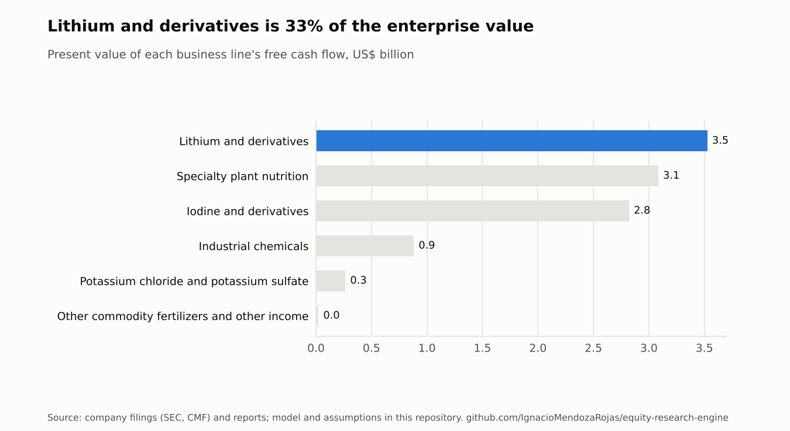
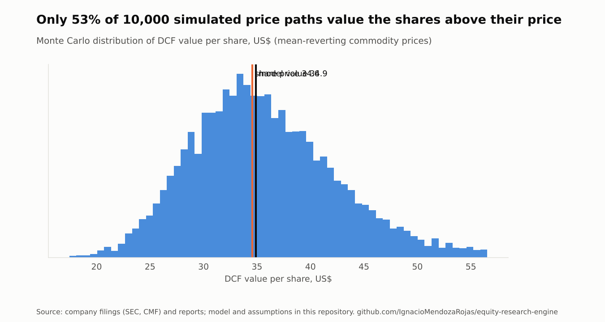
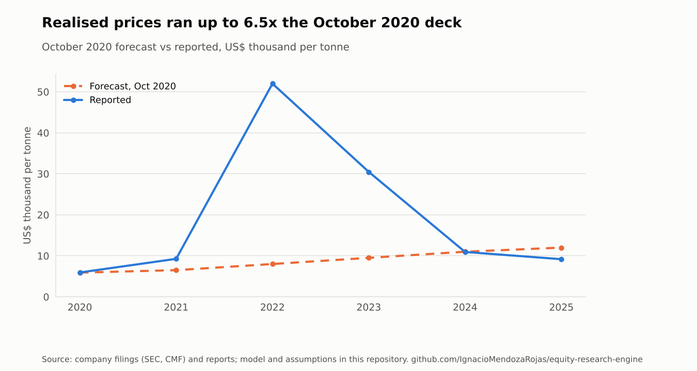

# SQM: Retrospective: the October 2020 valuation

*Sociedad Química y Minera de Chile S.A. · NYSE: SQM · Santiago: SQM-B · valuation date 16 October 2020*

> Prepared with public information only, as a portfolio exercise. Not investment advice.

## Investment summary

|  | Value |
|---|---|
| Rating | HOLD |
| Target price (CLP) | 27,409 |
| Share price (CLP), 16 Oct 2020 | 27,158 |
| Upside / downside | +0.9% |
| Target price (US$) | 34.89 |
| Shares outstanding (m) | 263.2 |
| Market capitalisation (US$ m) | 9,100 |
| Net financial debt (US$ m, 2019-12-31) | 686 |
| Enterprise value at market (US$ m) | 9,834 |
| Discount rate (WACC) | 7.25% |

**What the model said in October 2020.** With only the information available on 16 October 2020, the model valued SQM at US$34.89 per share (CLP 27,409), against a price of CLP 27,158. That is a **HOLD** at +1%. The DCF gives US$36.62 and the residual income model gives US$30.86. The price implied a long-run lithium price of about US$11,800/t, in line with the US$12,000/t deck.

**What happened next.** The lithium price went from about US$6,000/t to US$52,000/t in two years, then fell back. The model's 2025 volume of 180 kt was beaten by 30%, and its revenue path was beaten every year. Yet the backtest below shows the value that hindsight adds is smaller than the move in the shares:

- **The spike was captured by Corfo and the tax authority.** The 2018 lease takes 40% of every dollar of price above US$10,000/t, and then income tax applies.
- **The extra volume came with extra capex.** Capex in 2022-2024 was three to six times what the model assumed.
- **The Codelco agreement cut the post-2030 share to about 15%.**

The rise in the share price since 2020 is mostly a higher long-run lithium price in investors' minds, not cash already earned.

## Valuation

Blended target: **70% DCF (US$36.62) + 30% residual income (US$30.86) = US$34.89 per share.** Both use the same projection and the same cost of equity. The projection is built by segment as volume × price, with the Corfo lease, levies, capex tied to capacity, and the fiscal regime of each period. It runs explicitly to 2060, so the terminal value is only 12% of the enterprise value.

<picture>
  <source media="(prefers-color-scheme: dark)" srcset="figures/value-by-segment-2020-10-16-dark.png">
  
</picture>

**From enterprise to equity value** (balance sheet 2019-12-31)

|  | Value |
|---|---|
| Enterprise value (DCF) | 10,594.6 |
| + Cash and equivalents | 588.5 |
| + Other current financial assets | 505.5 |
| - Financial debt | -1,779.9 |
| - Minority interests | -48.2 |
| +/- Other (see assumptions) | -222.0 |
| = Equity value | 9,638.6 |
| Per share (US$) | 36.6 |

**Discount rate**

|  | Value |
|---|---|
| Risk-free rate | 1.23% |
| Equity risk premium (mature market) | 5.20% |
| Country risk premium x exposure | 0.84% x 1.00 |
| Unlevered beta (EBITDA-weighted) | 1.03 |
| Target debt / equity | 20.00% |
| Levered beta | 1.18 |
| Cost of equity | 8.23% |
| Pre-tax cost of debt | 3.23% |
| WACC | 7.25% |

No size premium and no company-specific premium: company risks are in the cash flows and the scenarios. The unlevered beta blends lithium and chemicals betas by each group's share of SQM's projected EBITDA.

**Projection (US$ m unless stated)**

|  | 2020 | 2021 | 2022 | 2023 | 2024 | 2025 |
|---|---|---|---|---|---|---|
| Revenue (consolidated) | 1,810 | 2,112 | 2,532 | 2,983 | 3,475 | 3,939 |
| EBITDA, 100% basis | 505 | 608 | 792 | 1,005 | 1,224 | 1,414 |
| EBITDA, SQM's economic share | 505 | 608 | 792 | 1,005 | 1,224 | 1,414 |
| Capex | 393 | 292 | 316 | 152 | 177 | 200 |
| Free cash flow to SQM | 112 | 55 | 148 | 474 | 602 | 718 |
| Lithium volume (kt) | 62 | 90 | 120 | 140 | 160 | 180 |
| Lithium price (US$/t) | 5,900 | 6,500 | 8,000 | 9,500 | 11,000 | 12,000 |

*100% basis* includes every operation in full, after lease payments while they apply. *SQM's economic share* applies each period's fiscal regime: where the state's take is set as a share of the margin, lease payments are part of that take, so the 100% figure can jump when a lease ends.

**DCF value per share (US$): discount rate × long-run lithium price (US$/t)**

|  | 8,400 | 10,200 | 12,000 | 13,800 | 15,600 |
|---|---|---|---|---|---|
| 6.25% | 38.7 | 42.5 | 46.0 | 49.5 | 52.9 |
| 6.75% | 34.1 | 37.6 | 40.8 | 44.1 | 47.3 |
| 7.25% | 30.3 | 33.6 | 36.6 | 39.6 | 42.6 |
| 7.75% | 27.2 | 30.3 | 33.1 | 35.9 | 38.7 |
| 8.25% | 24.6 | 27.5 | 30.2 | 32.8 | 35.4 |

**DCF value per share (US$): discount rate × terminal growth of perpetual segments**

|  | 0% | 1% | 2% | 3% |
|---|---|---|---|---|
| 6.25% | 43.1 | 44.3 | 46.0 | 48.8 |
| 6.75% | 38.8 | 39.7 | 40.8 | 42.6 |
| 7.25% | 35.2 | 35.8 | 36.6 | 37.8 |
| 7.75% | 32.1 | 32.5 | 33.1 | 33.9 |
| 8.25% | 29.4 | 29.7 | 30.2 | 30.7 |

**Scenarios**

|  | Scenario | Target (US$) | Upside | Rating |
|---|---|---|---|---|
| base | Assumptions as stated | 34.89 | +1% | HOLD |
| bear | Lithium settles at US$9,000/t and the concession is renewed only with 25% probability | 27.99 | -19% | SELL |
| bull | Lithium reaches US$16,000/t and the concession is renewed with 75% probability | 46.32 | +34% | BUY |

<picture>
  <source media="(prefers-color-scheme: dark)" srcset="figures/montecarlo-2020-10-16-dark.png">
  
</picture>

Prices follow a mean-reverting lognormal process around the deck (persistence φ = 0.7, annual volatility from the realised price history: Lithium and derivatives 40%, Iodine and derivatives 22%, Specialty plant nutrition 2%, Potassium chloride and potassium sulfate 19%). Median US$35.1, 5th-95th percentile US$25.7 to US$48.7.

**Model checks: what three common errors would do to this valuation**

|  | DCF per share (US$) | vs correct |
|---|---|---|
| Correct model | 36.62 | +0.0% |
| Perpetuity on the finite lithium concession | 38.51 | +5.2% |
| Terminal value discounted mid-year | 36.79 | +0.5% |
| Cash left out of the equity bridge | 32.46 | -11.4% |

## Backtest: forecast vs what happened

<picture>
  <source media="(prefers-color-scheme: dark)" srcset="figures/backtest-lithium-price-dark.png">
  
</picture>

**Forecast vs reported (US$ m unless stated)**

|  | 2020 | 2021 | 2022 | 2023 | 2024 | 2025 |
|---|---|---|---|---|---|---|
| Lithium volume, forecast (kt) | 62 | 90 | 120 | 140 | 160 | 180 |
| Lithium volume, reported (kt) | 65 | 101 | 157 | 170 | 205 | 233 |
| Lithium price, forecast (US$/t) | 5,900 | 6,500 | 8,000 | 9,500 | 11,000 | 12,000 |
| Lithium price, reported (US$/t) | 5,935 | 9,259 | 51,996 | 30,471 | 10,939 | 9,175 |
| Revenue, forecast | 1,810 | 2,112 | 2,532 | 2,983 | 3,475 | 3,939 |
| Revenue, reported | 1,817 | 2,862 | 10,711 | 7,467 | 4,529 | 4,576 |
| EBITDA, forecast | 505 | 608 | 792 | 1,005 | 1,224 | 1,414 |
| EBITDA, reported | 580 | 1,185 | 5,838 | 3,180 | 1,484 | 1,580 |
| Capex, forecast | 393 | 292 | 316 | 152 | 177 | 200 |
| Capex, reported | 322 | 465 | 905 | 1,104 | 972 |  |

<picture>
  <source media="(prefers-color-scheme: dark)" srcset="figures/backtest-value-walk-dark.png">
  
</picture>

|  | US$ per share | Change |
|---|---|---|
| Model in 2020 | 36.62 |  |
| + actual lithium prices to date | 45.42 | +8.80 |
| + actual prices and volumes, all segments | 50.52 | +5.10 |
| + actual capex | 45.96 | -4.56 |
| + Codelco agreement (state take 2025-2060) | 43.55 | -2.41 |

With perfect knowledge of 2020-2025, the October 2020 value would have been US$43.55 per share, +26% against the price then (US$34.57). Shareholders actually earned +89% including dividends (ADR dividend-adjusted price 31.84 in October 2020, peak 74.22 in 2022-12, 60.20 in 2026-10). What actually happened to 2025 explains about 29% of that return. The rest is what the market now expects from lithium after 2026; the 2026 report puts a price on it.

## Sources

- Financial statements: SEC EDGAR XBRL API (Form 20-F, CIK 909037), 2015-2024; SQM 4Q2025 earnings release (Form 6-K) for 2025.
- Segment revenue, volumes and gross-profit shares: SQM full-year earnings releases, Form 6-K, 2016-2025; 1H2026 run-rate from the 2Q2026 release.
- Corfo lease schedule: SQM Form 6-K of January 2018 describing the Corfo agreement.
- Nova Andino terms: Codelco and SQM announcements of 31 May 2024 and December 2025.
- Market data: see companies/sqm/data/market.csv and share_prices.csv for each value's source and date.
- Assumptions: companies/sqm/assumptions/2020-10-16.yaml, each with its rationale.
- Generated by eqr on 21 Oct 2026.
