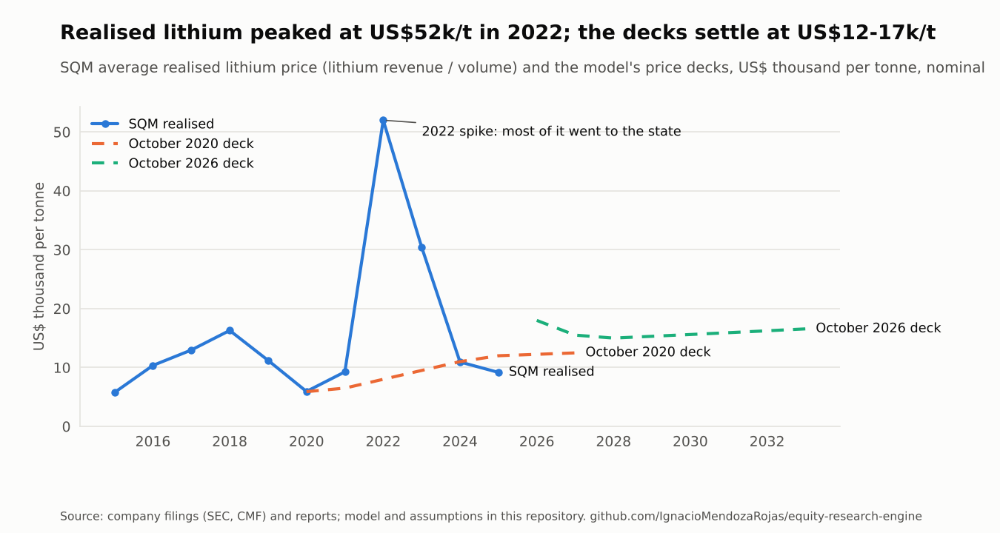
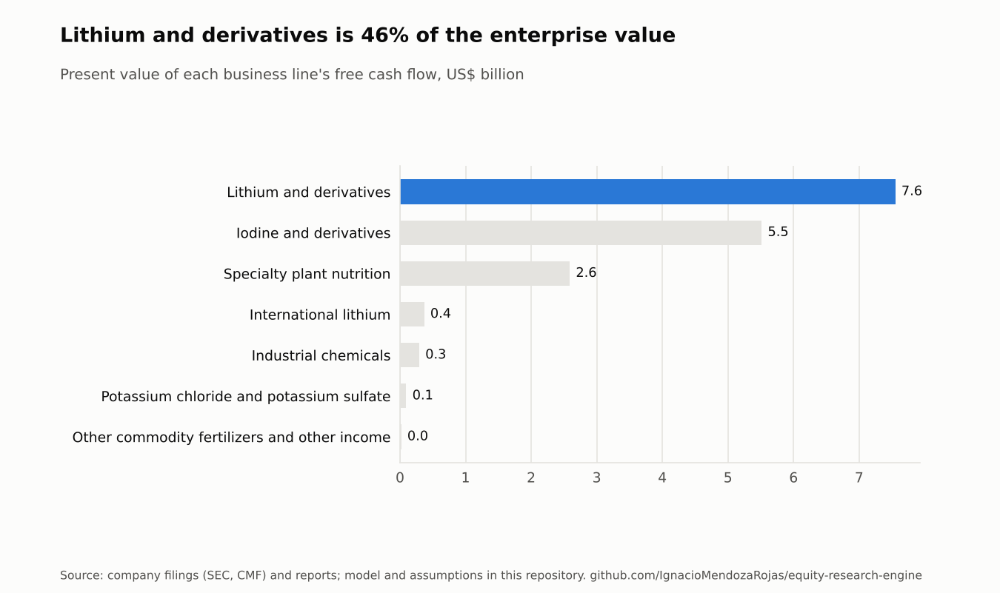
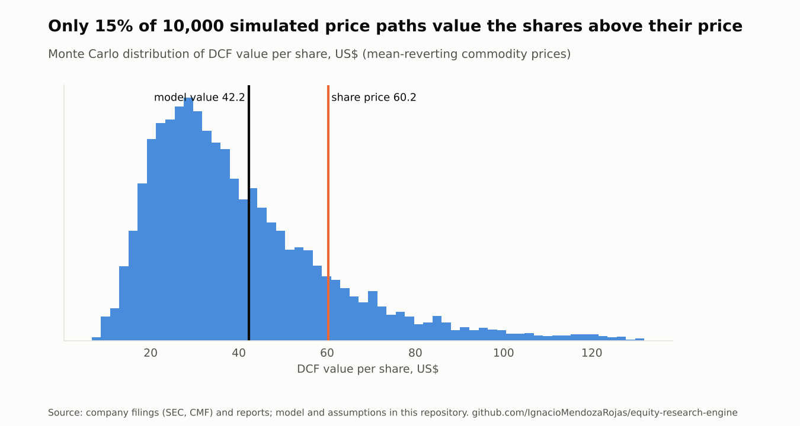

# SQM: Equity research report

*Sociedad Química y Minera de Chile S.A. · NYSE: SQM · Santiago: SQM-B · valuation date 16 October 2026*

> Prepared with public information only, as a portfolio exercise. Not investment advice.

## Investment summary

|  | Value |
|---|---|
| Rating | SELL |
| Target price (USD) | 42.23 |
| Share price (USD), 16 Oct 2026 | 60.23 |
| Upside / downside | -29.9% |
| Shares outstanding (m) | 285.6 |
| Market capitalisation (US$ m) | 17,204 |
| Net financial debt (US$ m, 2025-12-31) | 1,965 |
| Enterprise value at market (US$ m) | 21,531 |
| Discount rate (WACC) | 10.18% |

**The share price assumes lithium at about US$25,100/t from 2028 onwards; our deck uses US$15,000/t.** At US$60.23 per ADR, SQM trades 30% above our blended value of US$42.23 (DCF US$41.30, residual income US$44.40). We rate the shares **SELL**.

- **Lithium's spring is real but the state keeps most of it.** First-half 2026 realised prices doubled from 2025 (Q2 about US$21,800/t). Under the Nova Andino agreement with Codelco, about 70% of the Salar de Atacama margin goes to the state to 2030, and 85% from 2031 to 2060. Reported first-half earnings imply SQM keeps roughly 40% of the margin until 2030. From 2031 it keeps about 15%, and the concession ends in 2060, so no perpetuity is applied.
- **Iodine is now a third of the value.** It is worth US$5.5bn of the US$16.4bn enterprise value, at record prices (about US$73/kg in Q2 2026). It is SQM's least-discussed earnings line and its most exposed to a price normalisation.
- **The price paths are wide.** In 10,000 simulated commodity price paths, 15% value the shares above today's price. The 5th to 95th percentile range is US$16 to US$86.
- **What would change our view:** a long-run lithium price above about US$25,100/t, or a state take below the public headline for 2031-2060.

## Business description

SQM (Sociedad Química y Minera de Chile) produces lithium, iodine, specialty plant nutrients, potassium and industrial nitrates. It started in 1968 as a joint venture between Corfo, the Chilean state development agency, and Anglo Lautaro, and was privatised in the 1980s. Its Series B shares trade in Santiago, and as ADRs on the NYSE.

**Two ore bodies feed five business lines.**

- **Brine, Salar de Atacama (Antofagasta region).** Pumped brine is concentrated in solar evaporation ponds. It yields potassium chloride and sulfate, and lithium chloride, which is refined into lithium carbonate and hydroxide at the Salar del Carmen plants near Antofagasta. The salt flat is owned by Corfo and leased to SQM until the end of 2030. Since late 2025 the operation belongs to Nova Andino Litio, a joint company with Codelco. SQM manages it until 2030; Codelco takes control from 2031 to 2060.
- **Caliche ore (Tarapacá and Antofagasta regions).** Caliche is leached for iodine and nitrates, which become specialty plant nutrition, industrial chemicals (including the solar salts used to store heat in concentrated solar power plants), and part of the potassium nitrate supply. These mining concessions are owned outright.
- **Outside Chile, Mt Holland (Western Australia).** This is a hard-rock lithium mine and concentrator, with a hydroxide refinery being commissioned, operated in a 50:50 joint venture. SQM reports its share as the International Lithium Division.

**Where the money comes from.** Lithium was 13% of revenue in 2015 and 76% at the 2022 peak. Iodine and lithium together made 87% of 2025 gross profit. The table below uses SQM's own approximate allocation of gross profit by segment.

**2025 by business line**

|  | Revenue (US$ m) | Share of revenue | Volume (kt) | Share of gross profit |
|---|---|---|---|---|
| Lithium and derivatives | 2,138.7 | 47% | 233.1 | 45% |
| International lithium | 149.5 | 3% |  |  |
| Specialty plant nutrition | 982.4 | 21% | 1,012.9 | 11% |
| Iodine and derivatives | 1,042.8 | 23% | 14.5 | 42% |
| Potassium chloride and potassium sulfate | 155.5 | 3% | 327.6 | 1% |
| Industrial chemicals | 75.4 | 2% | 51.0 | 2% |
| Other commodity fertilizers and other income | 31.9 | 1% |  |  |

## Industry overview and competitive positioning

**Lithium is a price-taker's market with a cost curve and a policy overlay.** Brine producers in the Atacama sit at the bottom of the cash-cost curve. Hard-rock spodumene converted in China, and lepidolite, set the marginal cost. SQM's realised price went from about US$5,900/t in 2020 to US$52,000/t in 2022, then back to about US$9,200/t in 2025. That cycle came from new supply chasing electric-vehicle demand, then overshooting it. In 2026 prices recovered again. Guangzhou futures reached a 33-month high of 209,880 yuan/t in May, then fell to about 104,700 yuan/t (about US$15,600/t) by mid-October. SQM expects global demand above 2.1 million tonnes LCE in 2026.

**In Chile the state sets the share of the margin a producer keeps.** Corfo's 2018 lease charges a progressive rate on the carbonate price. The rate is 6.8% on the first US$4,000/t and 40% on every dollar above US$10,000/t (table below). That is why a price spike lifts SQM's earnings far less than its revenue. Since 2025 the national lithium strategy has put the Salar de Atacama under Nova Andino, with Codelco holding 50% + 1 of the shares. The headline state take of the operating margin is about 70% until 2030 and 85% from 2031 to 2060. Production of 280,000-300,000 t LCE a year is planned from 2031.

**Iodine is concentrated and Chilean.** Caliche-based producers in northern Chile supply most of the world's iodine, with Japan's brine producers next. Demand (X-ray contrast media, LCD polarising film, nutrition, disinfectants) grows with GDP and healthcare spending. Supply additions are slow. SQM's realised iodine price rose from about US$20,000/t in 2017 to about US$72,000/t in 2025.

**Specialty plant nutrition** (potassium nitrate, soluble fertilisers) earns a premium over commodity potash and moves with agricultural incomes. **Potassium chloride** is a commodity, and SQM has cut its volumes as brine is prioritised for lithium.

<picture>
  <source media="(prefers-color-scheme: dark)" srcset="figures/lithium-price-dark.png">
  
</picture>

**Corfo lease on lithium carbonate (2018 agreement, to 2030)**

| Lithium carbonate price (US$/t) | Corfo lease rate on that slice |
|---|---|
| 0 - 4,000 | 6.8% |
| 4,000 - 5,000 | 8.0% |
| 5,000 - 6,000 | 10.0% |
| 6,000 - 7,000 | 17.0% |
| 7,000 - 10,000 | 25.0% |
| 10,000 + | 40.0% |

## Valuation

Blended target: **70% DCF (US$41.30) + 30% residual income (US$44.40) = US$42.23 per share.** Both use the same projection and the same cost of equity. The projection is built by segment as volume × price, with the Corfo lease, levies, capex tied to capacity, and the fiscal regime of each period. It runs explicitly to 2060, so the terminal value is only 5% of the enterprise value.

<picture>
  <source media="(prefers-color-scheme: dark)" srcset="figures/value-by-segment-2026-10-16-dark.png">
  
</picture>

**From enterprise to equity value** (balance sheet 2025-12-31)

|  | Value |
|---|---|
| Enterprise value (DCF) | 16,423.8 |
| + Cash and equivalents | 1,750.3 |
| + Other current financial assets | 976.6 |
| - Financial debt | -4,691.4 |
| - Minority interests | -2,362.6 |
| +/- Other (see assumptions) | -300.0 |
| = Equity value | 11,796.7 |
| Per share (US$) | 41.3 |

**Discount rate**

|  | Value |
|---|---|
| Risk-free rate | 5.40% |
| Equity risk premium (mature market) | 4.23% |
| Country risk premium x exposure | 1.10% x 1.00 |
| Unlevered beta (EBITDA-weighted) | 0.99 |
| Target debt / equity | 25.00% |
| Levered beta | 1.17 |
| Cost of equity | 11.47% |
| Pre-tax cost of debt | 6.90% |
| WACC | 10.18% |

No size premium and no company-specific premium: company risks are in the cash flows and the scenarios. The unlevered beta blends lithium and chemicals betas by each group's share of SQM's projected EBITDA.

**Projection (US$ m unless stated)**

|  | 2026 | 2027 | 2028 | 2029 | 2030 | 2031 |
|---|---|---|---|---|---|---|
| Revenue (consolidated) | 7,830 | 7,222 | 7,193 | 7,454 | 7,645 | 7,683 |
| EBITDA, 100% basis | 3,206 | 2,835 | 2,762 | 2,850 | 2,908 | 4,100 |
| EBITDA, SQM's economic share | 1,910 | 1,738 | 1,690 | 1,746 | 1,792 | 1,513 |
| Capex | 551 | 515 | 514 | 531 | 447 | 448 |
| Free cash flow to SQM | 1,479 | 1,712 | 1,620 | 1,630 | 1,717 | 1,036 |
| Lithium volume (kt) | 275 | 285 | 295 | 300 | 300 | 290 |
| Lithium price (US$/t) | 18,000 | 15,500 | 15,000 | 15,300 | 15,606 | 15,918 |

*100% basis* includes every operation in full, after lease payments while they apply. *SQM's economic share* applies each period's fiscal regime: where the state's take is set as a share of the margin, lease payments are part of that take, so the 100% figure can jump when a lease ends.

**DCF value per share (US$): discount rate × long-run lithium price (US$/t)**

|  | 10,500 | 12,750 | 15,000 | 17,250 | 19,500 |
|---|---|---|---|---|---|
| 9.18% | 38.0 | 42.8 | 47.6 | 52.3 | 57.1 |
| 9.68% | 35.1 | 39.7 | 44.2 | 48.8 | 53.4 |
| 10.18% | 32.5 | 36.9 | 41.3 | 45.7 | 50.1 |
| 10.68% | 30.3 | 34.5 | 38.7 | 42.9 | 47.1 |
| 11.18% | 28.2 | 32.3 | 36.3 | 40.4 | 44.4 |

**DCF value per share (US$): discount rate × terminal growth of perpetual segments**

|  | 0% | 1% | 2% | 3% |
|---|---|---|---|---|
| 9.18% | 46.6 | 47.0 | 47.6 | 48.3 |
| 9.68% | 43.5 | 43.8 | 44.2 | 44.8 |
| 10.18% | 40.7 | 41.0 | 41.3 | 41.7 |
| 10.68% | 38.2 | 38.4 | 38.7 | 39.0 |
| 11.18% | 36.0 | 36.1 | 36.3 | 36.6 |

**Scenarios**

|  | Scenario | Target (US$) | Upside | Rating |
|---|---|---|---|---|
| base | Assumptions as stated | 42.23 | -30% | SELL |
| bear | Lithium falls back to US$11,000/t from 2027 | 33.69 | -44% | SELL |
| bull | Lithium holds US$20,000/t | 52.87 | -12% | HOLD |

<picture>
  <source media="(prefers-color-scheme: dark)" srcset="figures/montecarlo-2026-10-16-dark.png">
  
</picture>

Prices follow a mean-reverting lognormal process around the deck (persistence φ = 0.7, annual volatility from the realised price history: Lithium and derivatives 78%, Iodine and derivatives 20%, Specialty plant nutrition 21%, Potassium chloride and potassium sulfate 37%). Median US$35.4, 5th-95th percentile US$16.4 to US$85.7.

**Model checks: what three common errors would do to this valuation**

|  | DCF per share (US$) | vs correct |
|---|---|---|
| Correct model | 41.30 | +0.0% |
| Perpetuity on the finite lithium concession | 42.55 | +3.0% |
| Terminal value discounted mid-year | 41.43 | +0.3% |
| Cash left out of the equity bridge | 31.75 | -23.1% |

## Financial analysis

**History (US$ m)**

|  | 2015 | 2016 | 2017 | 2018 | 2019 | 2020 | 2021 | 2022 | 2023 | 2024 | 2025 |
|---|---|---|---|---|---|---|---|---|---|---|---|
| Revenue | 1,728 | 1,939 | 2,157 | 2,266 | 1,944 | 1,817 | 2,862 | 10,711 | 7,467 | 4,529 | 4,576 |
| EBITDA | 728 | 772 | 902 | 883 | 644 | 580 | 1,185 | 5,838 | 3,180 | 1,484 | 1,580 |
| EBITDA margin | 42% | 40% | 42% | 39% | 33% | 32% | 41% | 55% | 43% | 33% | 35% |
| Net income (owners) | 220 | 278 | 428 | 440 | 278 | 165 | 585 | 3,906 | 923 | 685 | 588 |
| ROE |  | 12% | 19% | 20% | 13% | 8% | 28% | 123% | 19% | 15% | 11% |
| Capex | 111 | 131 | 142 | 245 | 321 | 322 | 465 | 905 | 1,104 | 972 |  |
| Net financial debt |  | 469 | 254 | 485 | 686 | 1,111 | 205 | -699 | 2,103 | 2,307 | 1,965 |
| Dividends paid | 127 | 399 | 374 | 550 | 330 | 222 | 572 | 2,238 | 1,471 | 67 |  |

EBITDA here is gross profit − administrative expense + D&A, which matches SQM's reported adjusted EBITDA within rounding in 2023-2025. 2023 net income reflects the restatement in the 2024 20-F that moved most of the US$1.1bn specific mining tax charge into the years it relates to. The 2025 earnings release still shows it in 2024.

## Investment risks

Ranked by probability × impact.

|  | Risk | Probability (1-5) | Impact (1-5) | Score |
|---|---|---|---|---|
| M1 | Lithium price | 5 | 5 | 25 |
| M2 | Iodine price normalisation | 4 | 4 | 16 |
| R1 | State take and Nova Andino terms | 3 | 4 | 12 |
| L1 | Tax and legal disputes | 3 | 3 | 9 |
| O1 | Water, permits and community relations | 3 | 3 | 9 |
| O2 | Project execution | 3 | 2 | 6 |
| F1 | Currency and costs | 2 | 2 | 4 |

**M1 · Lithium price.** The single largest driver. Each 15% on the long-run deck moves value by about US$4-5 per share (sensitivity table). The progressive Corfo lease and the state take soften both the downside and the upside. *Mitigant:* Low position on the cost curve; the state shares the downside as well as the upside.

**M2 · Iodine price normalisation.** Iodine is at record prices and about a third of the enterprise value. The deck already assumes about US$60/kg from 2028, below the 2026 level. *Mitigant:* Concentrated supply and slow capacity additions.

**R1 · State take and Nova Andino terms.** The public terms give the state's share of the margin only as a headline. The 2026-2030 share is calibrated to reported earnings; the 2031-2060 share of about 15% is not yet observable. *Mitigant:* Signed agreement through 2060; SQM manages the operation until 2030.

**L1 · Tax and legal disputes.** The specific mining tax claim (US$1.1bn booked in 2024) is under appeal. A broader reading by the tax authority could reach future years. *Mitigant:* Already provisioned; the outcome of the appeal could release part of it.

**O1 · Water, permits and community relations.** Brine and water limits cap volumes. The 2031-2060 quota depends on new permits and on the indigenous consultation. *Mitigant:* Brine-reduction and water plans; the state partner aligns incentives.

**O2 · Project execution.** About US$3bn of capex in 2026-2028, the ramp-up of the Mt Holland refinery, and Chilean expansions. *Mitigant:* Projects are staged; sustaining capex is about US$300m a year.

**F1 · Currency and costs.** Revenue is in dollars and a large part of costs is in pesos; a stronger peso squeezes margins. *Mitigant:* Hedging; a weaker peso usually comes with weaker commodity prices.

## Environmental, social and governance

**Environment: water and brine are the license to operate.** Lithium in the Atacama is extracted by evaporating brine in one of the driest places on earth. Pumping limits and fresh-water rights are therefore the binding environmental constraints, and they are the issues that local communities and regulators press on. SQM's stated plans are to cut brine extraction and fresh-water use, and to make its products carbon neutral. Delivery against those plans is what matters for the 2031-2060 operating permits under Nova Andino.

**Social: indigenous consultation is now part of the deal.** Corfo is leading the indigenous consultation that the Nova Andino agreement requires. The 2018 Corfo lease already directs contributions to the region: 1.7% of SQM Salar's sales, US$10-15m a year to the communities, and US$10.8-18.9m a year to research and development.

**Governance: a state partner and a strategic shareholder.** From 2031 Codelco controls Nova Andino's board and management. Tianqi Lithium, a competitor, holds about 24% of SQM. In 2017 SQM settled US Foreign Corrupt Practices Act charges with the SEC and the Department of Justice over improper payments in Chile. The 2024-2025 dispute with Chile's tax authority over the specific mining tax on lithium is still open; SQM booked US$1.1bn and is contesting it.

**How ESG enters the numbers.** We do not add an ESG premium to the discount rate. Each risk sits where it would hit cash flows: water and permits in volumes, the state take in the fiscal regime, and taxes in the bridge.

## Sources

- Financial statements: SEC EDGAR XBRL API (Form 20-F, CIK 909037), 2015-2024; SQM 4Q2025 earnings release (Form 6-K) for 2025.
- Segment revenue, volumes and gross-profit shares: SQM full-year earnings releases, Form 6-K, 2016-2025; 1H2026 run-rate from the 2Q2026 release.
- Corfo lease schedule: SQM Form 6-K of January 2018 describing the Corfo agreement.
- Nova Andino terms: Codelco and SQM announcements of 31 May 2024 and December 2025.
- Market data: see companies/sqm/data/market.csv and share_prices.csv for each value's source and date.
- Assumptions: companies/sqm/assumptions/2026-10-16.yaml, each with its rationale.
- Generated by eqr on 21 Oct 2026.
